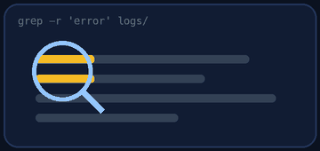
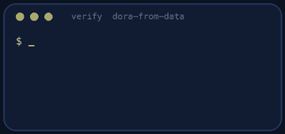

<p align="center"></p>

| | |
|-|-|
| **Time** | 60-75 min |
| **Cost** | free |
| **You need** | Python 3 |

## How this lab works

1. **Fork** this repository to your own GitHub account (button at the top right).
2. Clone **your fork** in your Ubuntu environment (WSL on Windows, your OrbStack machine on Mac).
3. Read the lab below (the same text is in [`LAB.md`](LAB.md)) and follow the mission.
4. Answer the questions in [`SUBMISSION.md`](SUBMISSION.md). Where a question asks for output, paste it in a code block. No screenshots needed.
5. Commit and push. Open the **Actions** tab of your fork (click *I understand my workflows, go ahead and enable them* the first time). The **Lab check** shows what is still missing.
6. When the check is green, **submit the URL of your fork** in the course platform.

> [!NOTE]
> The check only looks at your answers and any files the lab asks you to commit. Your instructor reads your work and may ask you to explain any line.

<p align="center"></p>

## 🎬 The situation

<p align="center"></p>

The CTO opens the quarterly review with a slide: *"We ship fast."* The head of QA says *"We break production every other release."* The team lead says *"Review is the thing that slows us down."* Everyone has an opinion, nobody has numbers.

You have 90 days of delivery data: every deployment, every incident, every ticket's journey from "work started" to "in production". Your job is to replace opinions with measurements, with the four **DORA metrics** and a **Kanban flow analysis**, and to tell the team where to look first.

> [!IMPORTANT]
> **Your mission**
> - Compute the four DORA metrics from raw CSV files and place the team on the performance scale
> - Find the bottleneck stage of the flow from ticket timestamps
> - Compare the first and the second half of the period and explain what changed
> - Recommend one experiment, with the numbers behind it

**Time:** 60-75 min | **Cost:** free | **You need:** Python 3

<p align="center"></p>

## Part 0 - Set the scene

Fork this repository and clone your fork. The data is in `data/`:

| File | Columns |
|------|---------|
| `deployments.csv` | `id`, `service`, `commit_time`, `deploy_time`, `status` (`success` or `failed`) |
| `incidents.csv` | `id`, `deployment_id`, `start`, `end` (every failed deployment caused one) |
| `tickets.csv` | `id`, `created`, `work_started`, `review_started`, `merged`, `deployed` |

All timestamps look like `2026-08-01 09:30`. The data starts on **2026-08-01 at 00:00** and covers 90 days.

<p align="center"></p>

## Part 1 - Recon: look before you calculate

<p align="center"></p>

1. Open the three files. How many rows has each? (`wc -l`)
2. Pick one deployment. What was its `commit_time` and `deploy_time`? How long did the change wait? Does it have an incident?
3. Pick one ticket and trace it: `created`, `work_started`, `review_started`, `merged`, `deployed`. Where did it spend the most time?
4. What does `status=failed` mean for the customer? How does this connect to `incidents.csv`?

> [!NOTE]
> **Predict** Without any calculation, write down your gut feeling: how often does the team deploy, how long do changes wait, how many deployments fail, how fast does the team recover? Compare with the numbers later.

<p align="center"></p>

## Part 2 - The four metrics

Write `dora.py` (standard library only: `csv`, `datetime`, `statistics`). It must print **exactly these 13 lines** (name, space, value), in this order:

```text
deployments_per_week 11.6
lead_time_hours_median 31.9
change_failure_rate_pct 8.1
time_to_restore_hours_median 3.4
level_deployment_frequency elite
level_lead_time high
level_change_failure_rate high
level_time_to_restore high
overall_level high
stage_median_hours_dev 17.8
stage_median_hours_review 47.7
stage_median_hours_deploy 11.4
bottleneck review
```

(The values above are for the whole period of your data. Your script has to work for any data of the same shape.)

**Definitions** (use these exactly):

- **Deployment frequency:** number of deployments in the period divided by the number of weeks of the period (the period is 90 days = 90/7 weeks, **not** the span between the first and last deployment).
- **Lead time for changes:** the **median** of `deploy_time - commit_time` in hours, over the deployments in the period.
- **Change failure rate:** failed deployments divided by all deployments, as a percentage.
- **Time to restore:** the **median** of `end - start` in hours, over incidents linked to deployments in the period (0.0 if there are none).
- **Levels** (deployment frequency per week, lead time in hours, failure rate %, restore hours):

| Level | Frequency | Lead time | Failure rate | Restore |
|-------|-----------|-----------|--------------|---------|
| elite | 7 or more | under 24 | 5 or less | under 1 |
| high | 1 or more | under 168 | 10 or less | under 24 |
| medium | 0.25 or more | under 720 | 15 or less | under 168 |
| low | below | above | above | above |

- **Overall level:** the **lowest** of the four. The chain is only as strong as its weakest link.
- **Stage times** are medians over tickets deployed in the period: `dev` = `review_started - work_started`, `review` = `merged - review_started`, `deploy` = `deployed - merged`. The **bottleneck** is the stage with the largest median.

**Arguments:** `python3 dora.py [DATA_DIR] [all|first|second]`. The default is `data` and `all`.

- `first` = days 0-44 and `second` = days 45-89 counted from 2026-08-01. Filter deployments by `deploy_time` and tickets by `deployed`; each half is 45 days = 45/7 weeks.
- A missing folder: print an error to stderr and exit with a non-zero code.

> [!TIP]
> **Checkpoint** Print the numbers for the whole period and compare with your Part 1 gut feeling. Which one surprised you?

<p align="center"></p>

## Part 3 - Reading the flow

Look at the three stage medians. Little's Law says: **cycle time = work in progress / throughput**. If tickets wait 48 hours in review and the team finishes about one ticket per day, how many tickets sit in review at any moment?

Count it from the data for one date: how many tickets are in `review` (between `review_started` and `merged`) on 2026-09-15 at noon? You can do it in a few lines of Python or a spreadsheet. If that number is big, a **WIP limit** on the review column would force the team to finish reviews before starting new work.

> [!NOTE]
> **Think** Propose a WIP limit for review. What do you expect to happen to the review wait? What is the cost to developers who would otherwise start a new ticket?

<p align="center"></p>

## Part 4 - Before and after

Something changed around day 45. Run:

```bash
python3 dora.py data first
python3 dora.py data second
```

For each of the four metrics, write whether it improved and by how much. What do you think the team changed? (Hint: look at which metrics moved the most and think about what would cause that.) Which metric moved the **least**, and why would that be harder to improve?

> [!WARNING]
> **Break it** A manager says: "Great, deployments went up eight times, so we should now require 20 deployments a week." Use the change failure rate and the restore time to argue what could go wrong when the number is chased instead of the outcome.

<p align="center"></p>

## Part 5 - Prove it

<p align="center"></p>

```bash
python3 verify.py
```

It compares your output with an independent reference on your data (all three periods) **and on a dataset it generates just now**, so hard-coded numbers fail.

<p align="center"></p>

## Level up (optional)

- **Weekly trend.** Print deployments per week for each week and spot the week when the practice changed. Plot it with a text bar chart.
- **Percentiles.** Report the 90th percentile lead time next to the median. When does the median hide a problem?
- **Cumulative flow.** From `tickets.csv` count tickets per state per day. In a cumulative flow diagram, which band widens when review is the bottleneck?

<!-- submission:start (generated by labs.py, do not edit) -->
## 📬 Submission

Answer the questions in `SUBMISSION.md` in **your fork** (paste output in code blocks where asked), push, then submit the **URL of your fork**.

**Files to commit**

- `dora.py`: your script, committed to the repo

**Questions to answer**

1. Paste the output of `python3 dora.py`. Which of the four metrics pulled the overall level down, and what level is the team?
2. The team changed how it works around day 45. Run your script on the first half and the second half of the data (see Part 4) and paste both. What improved, what did not, and what do you think they changed?
3. Which column of the board is the bottleneck? Show the numbers. Propose a WIP limit and explain what you expect it to do to cycle time (Little's Law).
4. Why is "deployment frequency" without "change failure rate" a dangerous number to optimise? Give an example.
5. Which metric would you improve first and what is your first concrete experiment?
6. Paste the output of `python3 verify.py`. It must end with **ALL CHECKS PASSED**.
<!-- submission:end -->
